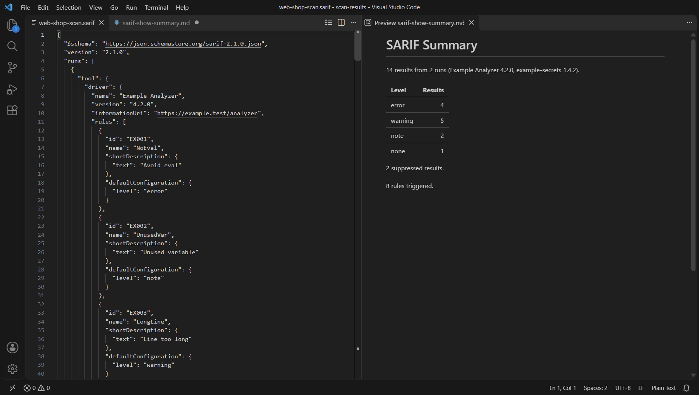
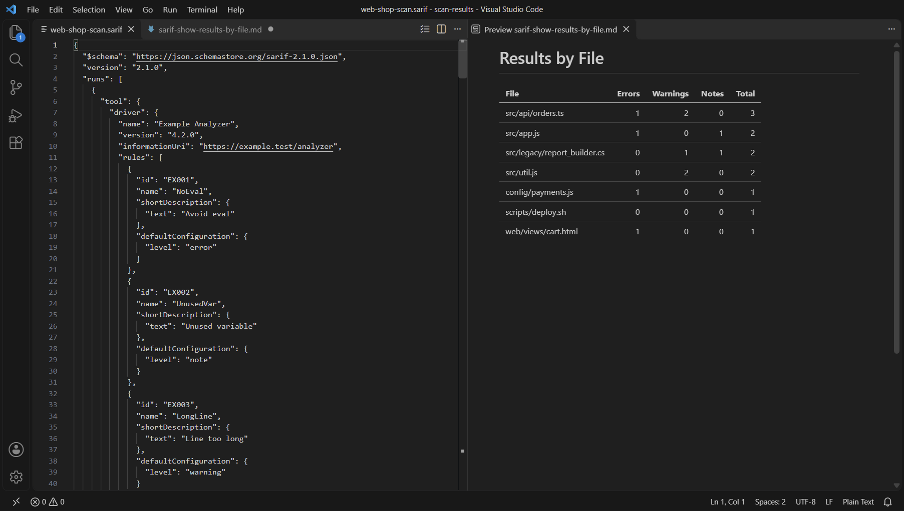
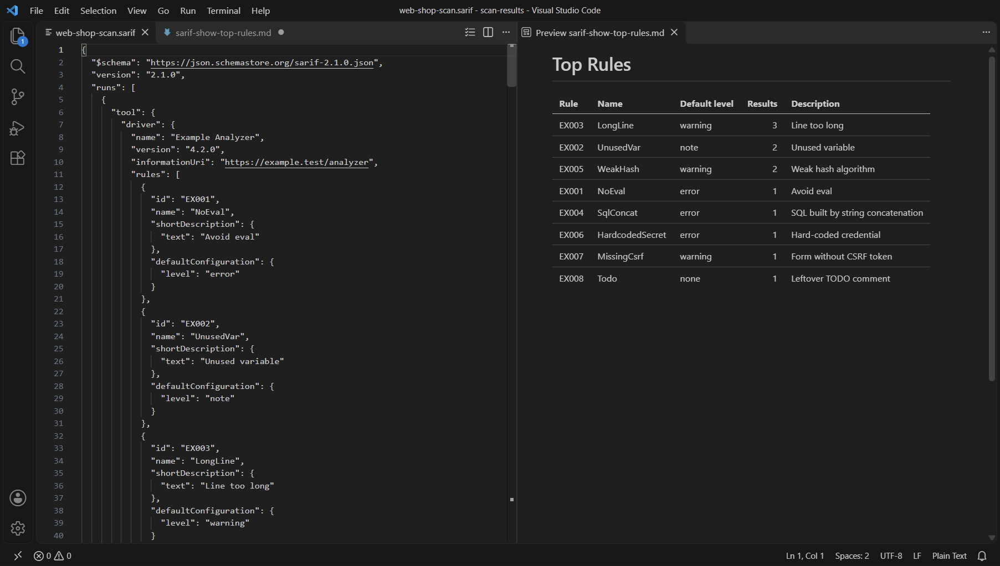
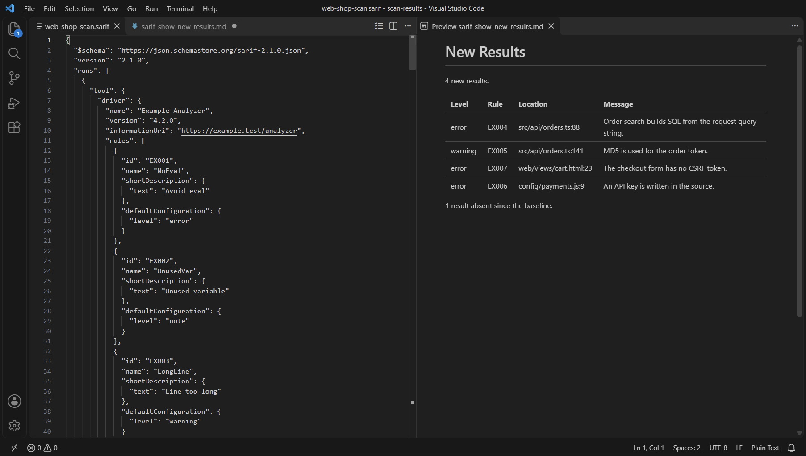
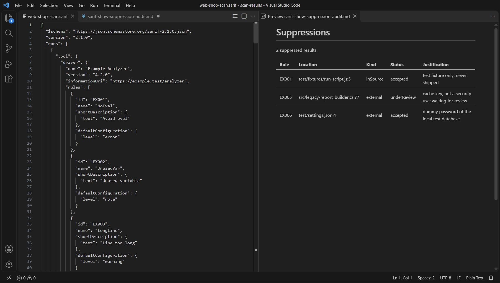

# SARIF Atlas

SARIF Atlas reads SARIF 2.1.0 files, the results format that code scanners, security tools and linters write, and turns them into clear Markdown reports: how many results each level has and which tools produced them, which files have the most results, which rules fire most often, the results that are new against a baseline, and every suppressed result with its kind, status and justification.

Everything runs on your computer. There is no telemetry. The only network request the extension ever makes is the licence check for the optional Pro tier (see [Privacy](PRIVACY.md)).

## What it does

* **Show Summary**: The log at a glance: results per level, the tools and versions that produced them, suppressed results and how many rules fired.
* **Show Results By File**: Every file with its errors, warnings, notes and total, the files with the most results first.
* **Show Top Rules**: The rules that fire most often, with their names, default levels and descriptions.
* **Show New Results** (Pro): The results that are new against the baseline, with level, rule, location and message, and how many are gone.
* **Show Suppression Audit** (Pro): Every suppression with its rule, location, kind, status and justification, for audits.

## Free, trial and Pro

| Feature | Free | Pro |
| --- | :---: | :---: |
| Show Summary | yes | yes |
| Show Results By File | yes | yes |
| Show Top Rules | yes | yes |
| Show New Results |  | yes |
| Show Suppression Audit |  | yes |
| Open Sample File, walkthrough, Report A Problem | yes | yes |

The free reports need no key, no account and no network connection, and they will not be moved behind the licence key later. The first Pro command starts a **free 14-day trial** on this computer. After that, Pro is a one-time purchase, not a subscription: **Pro Personal USD 19** (one person, use at work allowed) or **Pro Business USD 39 per user** (one key per user of an organisation). A key works on up to 3 computers. The checkout page shows the final price and any taxes for your country. Licence keys are sold by Dodo Payments, the merchant of record. Details: [licence](docs/licence.md), [terms](TERMS.md).

## Commands

Open the Command Palette and type `SARIF Atlas`.

| Command | Tier |
| --- | :---: |
| SARIF Atlas: Show Summary | Free |
| SARIF Atlas: Show Results By File | Free |
| SARIF Atlas: Show Top Rules | Free |
| SARIF Atlas: Show New Results | Pro |
| SARIF Atlas: Show Suppression Audit | Pro |
| SARIF Atlas: Open Sample File | Free |
| SARIF Atlas: Open Walkthrough | Free |
| SARIF Atlas: Show Documentation | Free |
| SARIF Atlas: Report A Problem | Free |
| SARIF Atlas: Buy Pro | Free |
| SARIF Atlas: Enter Licence Key | Free |
| SARIF Atlas: Show Licence Status | Free |
| SARIF Atlas: Remove Licence From This Machine | Free |

## Settings

| Setting | Default | Meaning |
| --- | --- | --- |
| `sarifAtlas.maxFileSizeMB` | 50 | Largest file a report reads (0.1 to 50 MB; VS Code passes files only up to 50 MB to extensions). |
| `sarifAtlas.openReportsAsPreview` | true | Open each report in the Markdown preview as well. |

## FAQ

**Does SARIF Atlas upload my scan results?**
No. Every report is created on your computer from the text in the editor, and nothing is sent anywhere.

**Which tools does it work with?**
Any tool that writes SARIF 2.1.0 in JSON: code scanners, security scanners and linters with a SARIF output option. Rules are found in the tool's driver and in its extensions, and results that refer to rules by id, by index or through a rule reference are all matched.

**What counts as a suppressed result?**
A result with at least one suppression whose status is accepted or not given, as SARIF 2.1.0 defines it. Suppressions under review or rejected do not hide a result; the Pro suppression audit lists every suppression with its status.

**How does the new-results report know what is new?**
From the baselineState that the scanning tool writes for each result when it compares a run with an earlier one. If the log has no baselineState, the report says so instead of guessing.

## For IT and procurement

* Publisher: SmallStepsStudio (Visual Studio Marketplace), smallstepsstudio (Open VSX).
* Network: one host, `live.dodopayments.com`, for the licence check only, and only after a key is entered. No telemetry. The trial uses no network.
* Files are read from the editor only; the extension writes no files and changes none.
* Source: <https://github.com/small-steps-studio/sarif-atlas>.
* Licence agreement: [LICENSE.txt](LICENSE.txt). Terms: [TERMS.md](TERMS.md). Privacy: [PRIVACY.md](PRIVACY.md).

## Support

Run **SARIF Atlas: Report A Problem** or open an issue at <https://github.com/small-steps-studio/sarif-atlas/issues>. Never post a licence key or confidential data in a public issue.

SARIF is an OASIS standard; SARIF Atlas is an independent product and is not affiliated with or endorsed by OASIS or by the makers of the tools that write SARIF files.
